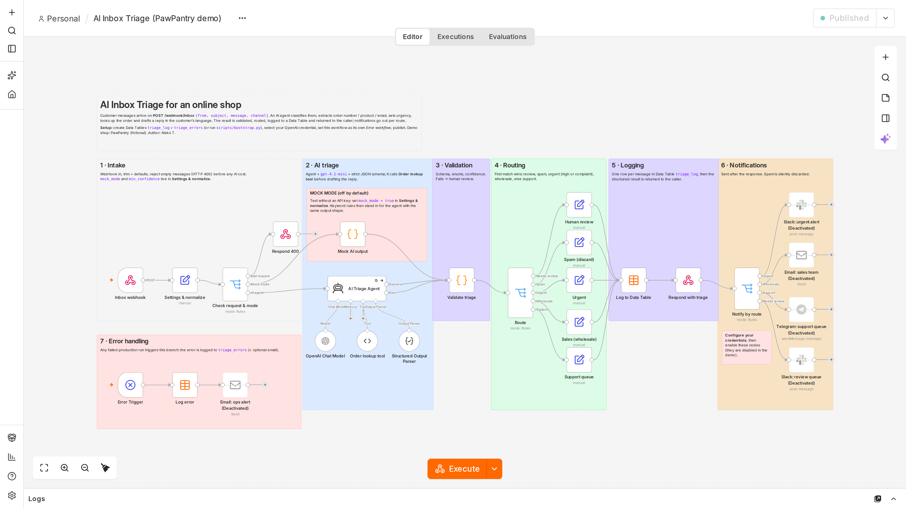
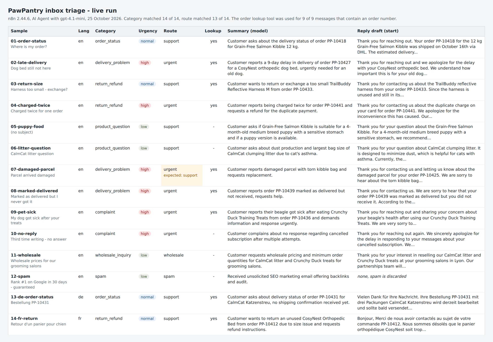
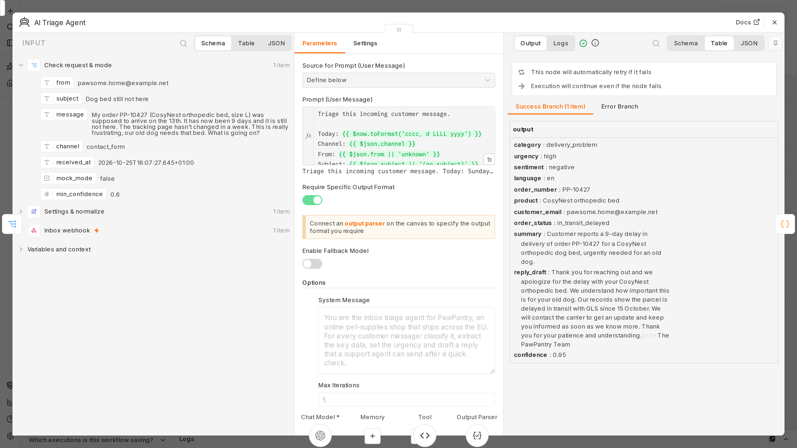

# AI Inbox Triage for an online shop (n8n + AI agent)

An importable **n8n workflow** that triages incoming customer messages for an e-commerce shop:
an AI agent classifies each message, extracts the order number, product and email, sets the
urgency, looks the order up, drafts a reply in the customer's language, and the workflow
validates, routes, logs and answers - automatically.

Built for the fictional pet-supplies shop **PawPantry**. Tested on **n8n 2.44.6** (Docker).



> **Status.** Tested in mock mode (no API key) and in one live run with `gpt-4.1-mini` on
> 25 October 2026. The live numbers are in [Live run results](#live-run-results).

---

## The problem

A small online shop gets the same mix every day: "where is my order?", returns, product
questions, damaged parcels, the occasional angry complaint, B2B requests and spam. Someone has
to read every message, decide who handles it, look up the order and type a reply. Urgent cases
(a sick pet, a double charge, a lost parcel) wait in the same queue as spam.

## What the workflow does

1. **Intake** - `POST /webhook/inbox` with `{from, subject, message, channel}`. Input is trimmed
   and defaulted; an empty message is rejected with HTTP 400 before any AI cost.
2. **AI triage** - an n8n **AI Agent** with an **OpenAI Chat Model** (`gpt-4.1-mini`) and a
   **Structured Output Parser** (strict JSON schema). The system prompt contains the category
   definitions, urgency rules and the shop's tone guide and policies; the user prompt carries
   today's date so the agent can judge late deliveries. The agent has an
   **Order lookup tool** (Code tool over a mock order database) and is told to call it before
   drafting a reply; the tool hides order details when the email does not match the order.
3. **Validation** - a Code node checks the AI answer (required fields, enums, empty reply,
   confidence below `min_confidence`). Agent failures arrive here too via the agent's error
   output. Anything wrong goes to **human review** instead of being guessed.
4. **Routing** - a Switch node, first match wins:

   | Route | Rule | Queue |
   |---|---|---|
   | Needs review | validation failed | `triage-review` |
   | Spam | `category = spam` | `discarded` (logged, no notification) |
   | Urgent | `urgency = high` **or** `category = complaint` | `support-urgent` |
   | Wholesale | `category = wholesale_inquiry` | `sales` |
   | Support | everything else | `support` |

5. **Logging** - one row per message in the n8n **Data Table** `triage_log` (22 columns:
   input, triage result, route, validation errors, mode, execution id).
6. **Response** - the webhook answers with the structured result (below).
7. **Notifications** - after the response, per route: Slack (urgent), email (sales),
   Telegram (support), Slack (review). They ship **disabled** with a "configure your
   credentials" note.
8. **Error handling** - the workflow is its own *error workflow*: an Error Trigger logs any
   failed production run (node, message, execution link) to the Data Table `triage_errors`,
   with an optional email alert (disabled).

Categories: `order_status`, `return_refund`, `product_question`, `delivery_problem`,
`complaint`, `wholesale_inquiry`, `spam`. Urgency: `low` / `normal` / `high`.
Sentiment: `positive` / `neutral` / `negative`. Language: ISO 639-1 code.

## Repository

```
workflows/ai-inbox-triage.json   the n8n workflow (26 nodes, 10 sticky notes)
docker-compose.yml               local n8n 2.44.6 (image pinned)
scripts/bootstrap.py             one-command setup of a local n8n via its API (stdlib only)
scripts/send_samples.py          posts the samples, prints a results table (stdlib only)
scripts/screenshot.py            Playwright screenshots of the canvas / executions / tables
scripts/results_table.py         turns the send_samples.py results into an HTML table
scripts/live_run.md              checklist for the run with a real OpenAI key
samples/inquiries.json           14 customer messages (12 English, 1 German, 1 French)
samples/edge_cases.json          empty message, malformed AI output, crash (last two: mock only)
assets/screenshots/              README images
```

## Quick start (local, mock mode, no API key)

```bash
docker compose -p n8n-triage-demo up -d

export N8N_OWNER_EMAIL=you@example.com N8N_OWNER_PASSWORD='Choose-a-local-passw0rd'
python3 scripts/bootstrap.py --mock      # owner account, API key, Data Tables, credential, import, publish
python3 scripts/send_samples.py --edge-cases --show-replies
```

Open <http://localhost:5678> to watch the executions. `bootstrap.py` is idempotent: run it
again after editing the JSON, or without `--mock` to switch to live mode. For live mode,
`OPENAI_API_KEY` is read once from the environment to create the credential; later runs
without it leave the stored credential alone.

## Import into your own n8n (no scripts)

1. **Import**: create a new workflow, then *... -> Import from File* (or *Import from URL* with
   the raw GitHub link of `workflows/ai-inbox-triage.json`).
2. **Data Tables**: create `triage_log` and `triage_errors` (*Overview -> Data tables*). Column
   names and types are listed in `DATA_TABLES` at the top of `scripts/bootstrap.py`
   (`received_at`/`failed_at` = date, `confidence` = number, `needs_review` = boolean, the rest string).
   The Data Table nodes select tables **by name**, so no IDs need editing.
3. **OpenAI credential**: open *OpenAI Chat Model* and select or create a credential named
   **OpenAI account**. The JSON contains only a reference by name, never a key.
4. **Publish**, then *Workflow settings -> Error workflow ->* select this same workflow and
   publish again (n8n only offers published workflows that contain an Error Trigger).
5. **Notifications** (optional): add Slack / SMTP / Telegram credentials, set channel, chat id
   and addresses, then enable the four notification nodes and the ops email node.
6. Test:

```bash
curl -s -X POST http://localhost:5678/webhook/inbox -H 'Content-Type: application/json' \
  -d '{"from":"buyer.4821@example.com","subject":"Where is my order?","message":"Hi, where is order PP-10418?","channel":"email"}'
```

Before exposing the webhook publicly, enable authentication on the *Inbox webhook* node
(header auth or basic auth) or put it behind your reverse proxy.

## Webhook response

Real response from the live run (sample `02-late-delivery`, 3.4 s). `order_status` comes from
the order lookup tool, and the reply uses the carrier and the last scan date it returned.

```json
{
  "ok": true,
  "log_id": 3,
  "route": "urgent",
  "queue": "support-urgent",
  "needs_human_review": false,
  "triage": {
    "category": "delivery_problem",
    "urgency": "high",
    "sentiment": "negative",
    "language": "en",
    "confidence": 0.95,
    "summary": "Customer reports a 9-day delay in delivery of order PP-10427 for a CosyNest orthopedic dog bed, urgently needed for an old dog."
  },
  "extracted": {
    "order_number": "PP-10427",
    "product": "CosyNest orthopedic bed",
    "customer_email": "pawsome.home@example.net",
    "order_status": "in_transit_delayed"
  },
  "reply_draft": "Thank you for reaching out and we apologize for the delay with your CosyNest orthopedic bed. We understand how important this is for your old dog. Our records show the parcel is delayed in transit with GLS since 15 October. We will contact the carrier to get an update and keep you informed as soon as we know more. Thank you for your patience and understanding.\n\nThe PawPantry Team",
  "validation_errors": [],
  "mode": "live",
  "execution_id": "5"
}
```

When validation fails, `route` is `human_review`, `needs_human_review` is `true` and
`validation_errors` lists the reasons (for example `missing urgency`, `low confidence (<value>)`,
`AI step failed: Connection error.`). An empty message returns HTTP 400 `{"ok": false, "error": "Field 'message' is required."}`.

## Mock mode vs live mode

| | Mock mode | Live mode |
|---|---|---|
| Switch | `mock_mode = true` in **Settings & normalize**, or `bootstrap.py --mock` | `mock_mode = false` (the default in the JSON), or `bootstrap.py` |
| What answers | **Mock AI output** Code node: keyword rules and reply templates (en/de/fr) | AI Triage Agent + `gpt-4.1-mini` + Order lookup tool |
| Needs | nothing | an OpenAI credential named "OpenAI account" |
| Output shape | identical `{ output: {...} }`, so validation, routing, logging, response and notifications run unchanged | |
| Extra test hooks | `[[mock:invalid]]` in a message -> malformed answer -> human review; `[[mock:crash]]` -> failed run -> error log | |

Mock mode exists to test the plumbing without spending tokens. Its labels come from simple
rules written alongside the samples, so mock results say nothing about AI accuracy.

## Tests without an API key (mock mode, n8n 2.44.6)

On a freshly created n8n instance (`down -v`, `up -d`, `bootstrap.py --mock`):

```
id                      http  lang  category             urg     route           order      conf  sec
-------------------------------------------------------------------------------------------------------
01-order-status         200   en    = order_status       normal  = support       PP-10418   0.9   0.2
02-late-delivery        200   en    = delivery_problem   high    = urgent        PP-10427   0.9   0.1
03-return-size          200   en    = return_refund      normal  = support       PP-10433   0.9   0.1
04-charged-twice        200   en    = return_refund      high    = urgent        PP-10441   0.9   0.1
05-puppy-food           200   en    = product_question   low     = support       -          0.9   0.1
06-litter-question      200   en    = product_question   low     = support       -          0.9   0.1
07-damaged-parcel       200   en    = delivery_problem   normal  = support       PP-10425   0.9   0.1
08-marked-delivered     200   en    = delivery_problem   high    = urgent        PP-10439   0.9   0.1
09-pet-sick             200   en    = complaint          high    = urgent        PP-10436   0.9   0.1
10-no-reply             200   en    = complaint          normal  = urgent        -          0.9   0.1
11-wholesale            200   en    = wholesale_inquiry  low     = wholesale     -          0.9   0.1
12-spam                 200   en    = spam               low     = spam          -          0.9   0.1
13-de-order-status      200   de    = order_status       normal  = support       PP-10431   0.9   0.1
14-fr-return            200   fr    = return_refund      normal  = support       PP-10412   0.9   0.1
e1-missing-message      400=  Field 'message' is required.  (0.1 s)
e2-malformed-ai-output  200   -       not_a_category     -       = human_review  -          0     0.1
e3-workflow-crash       500=  Error in workflow  (0.1 s)
```

Checked afterwards through the n8n API:

- `triage_log` holds 15 rows (14 samples + the malformed case; the HTTP 400 request is not
  logged), with the expected routes and queues; `triage_errors` holds 1 row for the crash with
  node name, message and execution link written by the Error Trigger run.
- Disabled notification nodes pass data through, so the dispatch Switch is exercised.
- **Agent wiring without AI calls**: live mode with the credential pointed at an unreachable
  local address (`OPENAI_BASE_URL=http://127.0.0.1:9/v1`, placeholder key). The agent built its
  prompt (system message, tone guide and the rendered customer message are visible in the
  execution), the model call failed with `Connection error.`, the agent's error output sent the
  item to validation, and the request ended as `human_review` with HTTP 200. No request left the machine.
- **Output schema** compiled with n8n's own JSON-schema-to-zod converter: all 14 mock answers
  accepted; an incomplete object and an object with an extra key rejected.
- **Order lookup tool** code run directly in Node with 4 inputs: match, number without prefix,
  wrong email (details withheld), unknown number.
- The raw repository JSON also imports through the n8n CLI (`n8n import:workflow`); there the
  credential placeholder was re-linked by name to the existing "OpenAI account" credential.

## Adapting it to a real shop

The triage core (agent, validation, routing, logging) stays the same; only the edges change.
All nodes named below exist in n8n 2.44.6, and the WooCommerce, Shopify, Zendesk, Gmail,
Microsoft Outlook, Freshdesk and Help Scout nodes can be attached to the agent as tools.

| Source / target | Replace | With |
|---|---|---|
| **Gmail** | Inbox webhook | *Gmail Trigger* (label filter), map sender, subject and text in *Settings & normalize*; write the reply as a Gmail **draft** so a person approves it |
| **Outlook / Microsoft 365** | Inbox webhook | *Microsoft Outlook Trigger*, reply as a draft with the *Microsoft Outlook* node |
| **Zendesk** (or Freshdesk, Help Scout) | Inbox webhook + notifications | *Zendesk Trigger* on new tickets; instead of Slack/Telegram, update the ticket: tags from category and urgency, group from route, draft reply as an internal note |
| **WooCommerce** | Order lookup tool | the *WooCommerce* node as an agent tool (order: get) or an HTTP Request tool on `/wp-json/wc/v3/orders`; keep the email check before returning details |
| **Shopify** | Order lookup tool | the *Shopify* node as an agent tool |
| Logging at scale | Data Tables | Postgres / Google Sheets / your helpdesk; Data Tables are fine for a demo and small volumes |

Also adjust: the order number pattern (`PP-12345`) in the system prompt, the policies and
tone guide, `min_confidence`, and the queue names.

## Cost notes

From the live run (details below): a message with an order number took 2 model calls, one
without took 1. My estimate is about 2,900 input and 200 output tokens per message, which is
roughly USD 0.0015 per message, or USD 1.50 per 1,000 messages, at the `gpt-4.1-mini` list
price I used (USD 0.40 per 1M input and 1.60 per 1M output tokens; check current pricing).
These are estimates, not billed figures. Empty messages are rejected before the agent, and
mock mode costs nothing.

## Limitations

- Tested on 14 sample messages in one live run. That is a smoke test, not an accuracy study.
- The agent has no product catalog. In the live run it answered product questions with facts it
  had no source for. Give it a catalog tool, or tell it to leave product facts to an adviser.
- Confidence is the model's own estimate, not a calibrated probability. In the live run it
  said 0.95 for 13 of 14 messages, so the `min_confidence` check rarely fires on its own.
- One webhook call is one message. For batch triggers (a Gmail poll can return several mails),
  run one message per execution, for example with Loop Over Items before the triage.
- One message at a time: no thread history, deduplication or attachment handling.
- Reply drafts are never sent automatically - by design a person approves them.
- Customer text goes to the model. The agent only has a read-only lookup that withholds
  details on email mismatch and every answer is schema-validated, but treat drafts as untrusted.
- Messages and email addresses are stored in a Data Table and sent to OpenAI: define retention
  and check your data-processing terms (GDPR) before production use.
- The webhook ships without authentication (local demo); enable it before going public.
- The error workflow must be set after the first publish (n8n only accepts published workflows).
- n8n runs its task runner in internal mode here (fine locally; n8n recommends external runners in production).

## Live run results

One live run on 25 October 2026: n8n 2.44.6 in Docker, the AI Agent with `gpt-4.1-mini`
(OpenAI Responses API, temperature 0.2), a fresh instance set up with `bootstrap.py`. I sent
one test message, then the 14 samples and the edge cases. The empty message got HTTP 400 and
never reached the model. The two mock-only edge cases were skipped.



The category matched the expected label for all 14 samples. The route matched for 13 of 14.
The one difference is `07-damaged-parcel`: a torn bag of food with "food everywhere". The
model rated it high urgency, so it went to the urgent queue instead of normal support. You can
argue for either. I kept the expected label as it was. No message went to human review. Each
message took 1.6 to 3.7 seconds, 2.8 seconds on average.

The agent called the order lookup tool for all 9 samples that contain an order number, once
each, and never for the others. Every lookup found the order and the email matched. The
replies then used what the tool returned: carrier, dates, "left at front door", the GLS delay
since 15 October.



The whole session made 25 model calls: 2 for the test message and 23 for the samples (2 per
message with an order number, 1 per message without). n8n 2.44.6 did not store real token
counts for these calls. It only stores its own estimate of the prompt (`tokenUsageEstimate`,
with 0 completion tokens), which adds up to 26,764 tokens. That figure leaves out the tool
definitions and the model's answers. I counted those with the `o200k_base` tokenizer: about
674 tokens of tool definitions per call and 3,124 output tokens in total. So my estimate for the
session is about 43,600 input and 3,100 output tokens. At USD 0.40 and 1.60 per million that is
about USD 0.02 for the 15 messages. The OpenAI usage page has the billed numbers.

Two replies as the model wrote them:

> Thank you for reaching out and sharing your concern about your beagle's health after using
> our Crunchy Duck Training Treats. We are very sorry to hear about your dog's illness and
> understand your worry. Please contact your vet immediately if your dog is still unwell. Could
> you please provide the batch number printed on the pack? Our team lead will personally review
> this issue and follow up with you within 24 hours. [...]

> Bonjour, Merci de nous avoir contactés au sujet de votre commande PP-10412. Nous sommes
> désolés que le panier orthopédique CosyNest soit trop grand pour votre chien. Vous pouvez
> retourner l'article non utilisé dans son emballage d'origine. [...]

What the live run showed that mock mode could not:

The first live message crashed the validation step with `Cannot read properties of undefined
(reading 'pairedItem')`. The code looked up the original request with `$('Settings &
normalize').item`, and n8n loses that link after an AI Agent has called a tool. The mock path
and the agent error path never call a tool, so they passed. The fix reads the request with
`.first()`, which is safe because one webhook call carries one message. I checked it by
retrying the failed execution on the new version. The retry reused the stored model answer, so
it cost no extra calls.

The first reply also said an order "is expected to arrive by October 21" on 25 October. The
agent did not know the date, and the urgency rule about late deliveries needs it. The prompt
now starts with today's date. This went in before the 14 samples ran.

Rerunning `bootstrap.py` without the key would have replaced the stored key with the
placeholder. It now keeps an existing credential when `OPENAI_API_KEY` is not set.

Things I would tune next, left as they are so the table matches the workflow in this repo.
In `05-puppy-food` the reply mentions "puppy-specific formulas", and in `06-litter-question`
it says the litter "is designed to minimize dust" and that 10 L is the largest bag. The agent
had no data for either claim (see Limitations). The return reply in `03` does not mention that
returns are free. The reply in `01` notices the delivery date has passed but still asks the
customer to wait a couple of days.

## License

MIT - see [LICENSE](LICENSE). Author: Aleks T.
PawPantry, its products, orders and customers are fictional; all email addresses use example domains.
